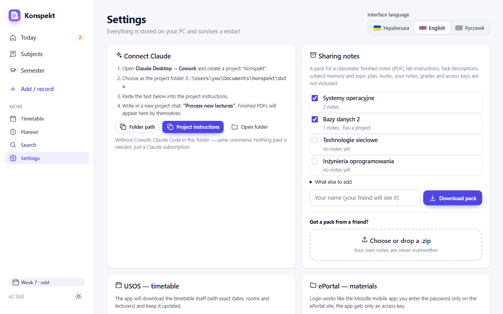
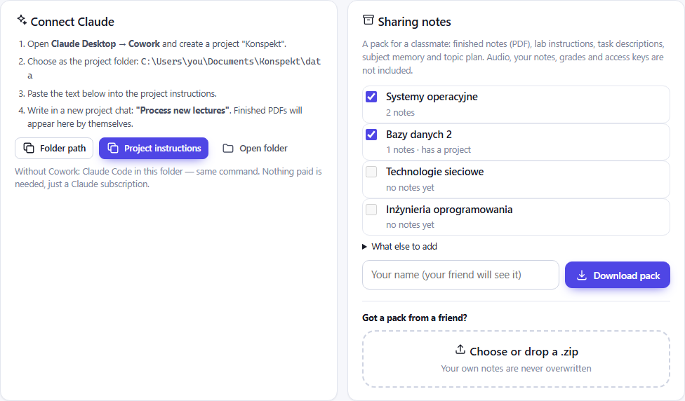
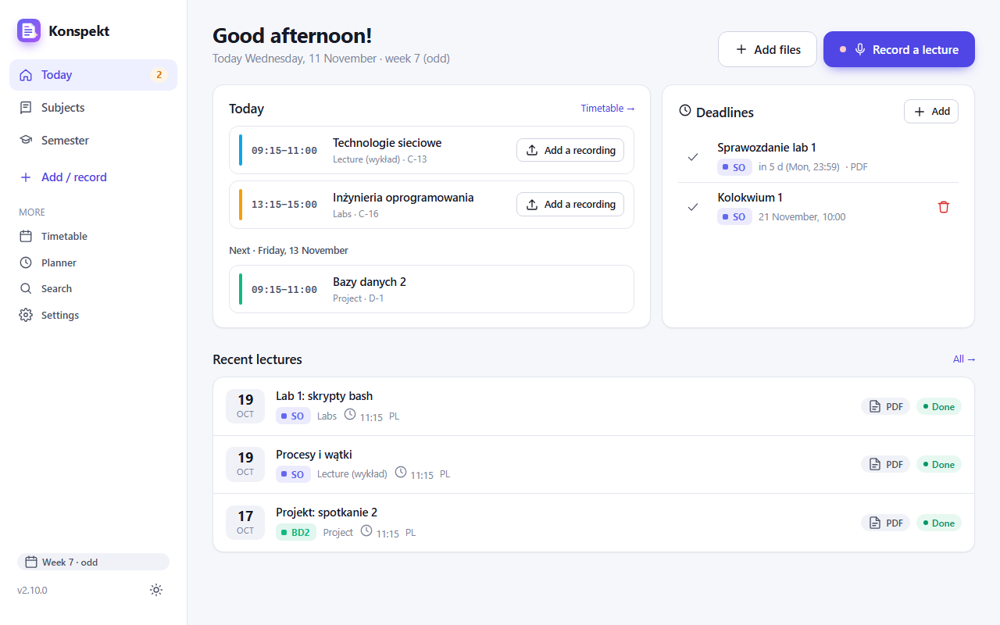
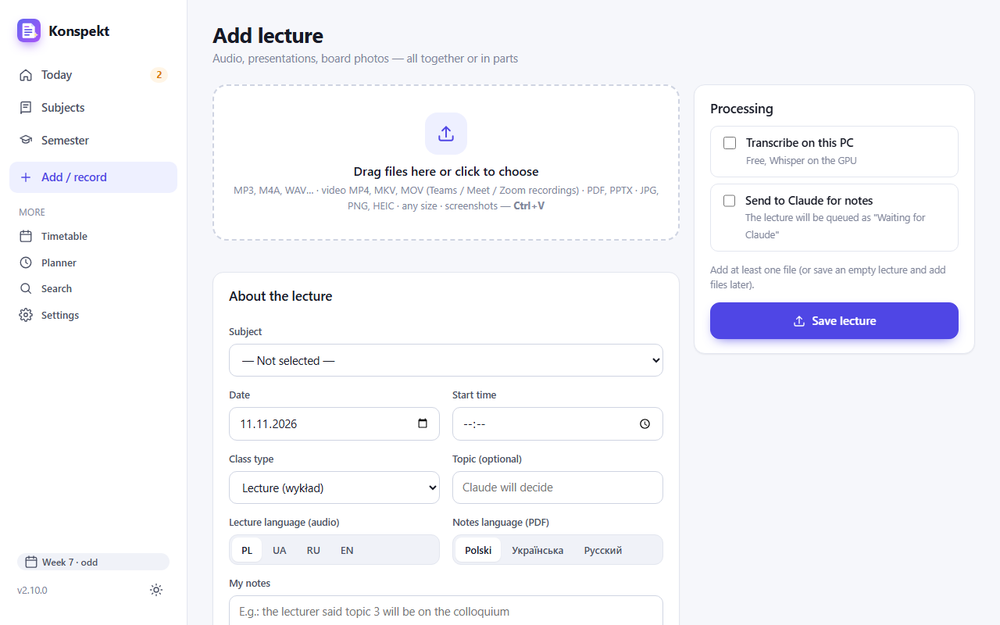
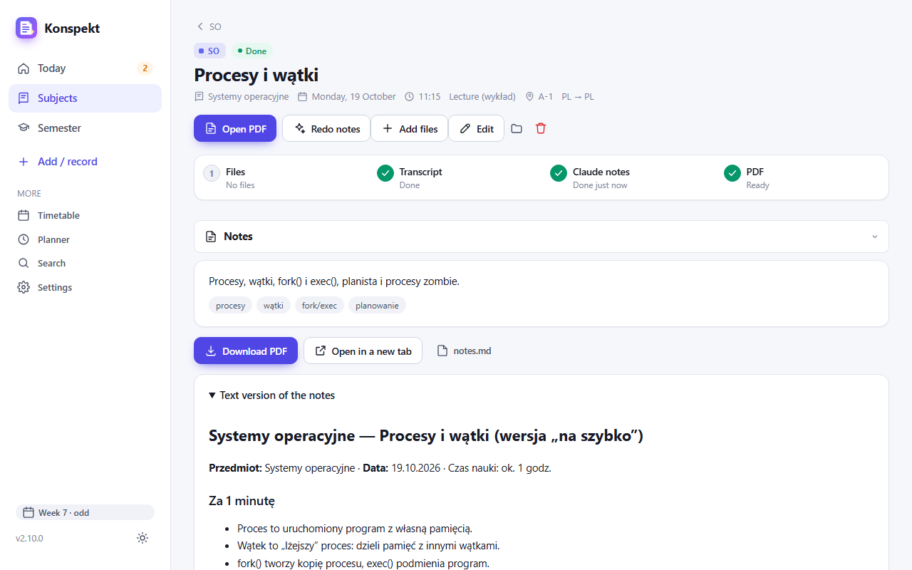
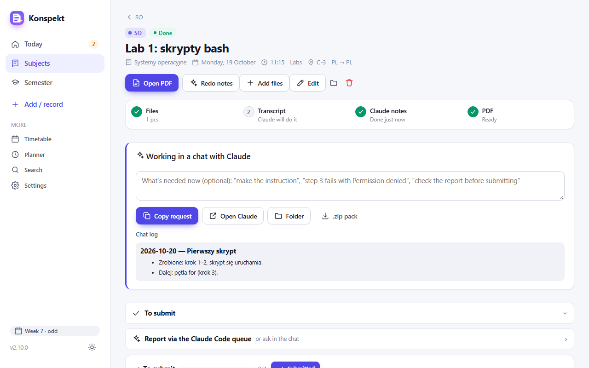
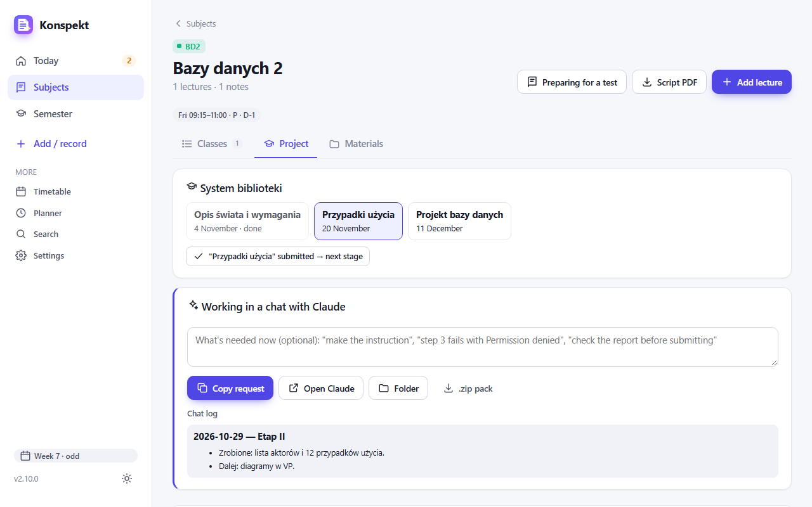
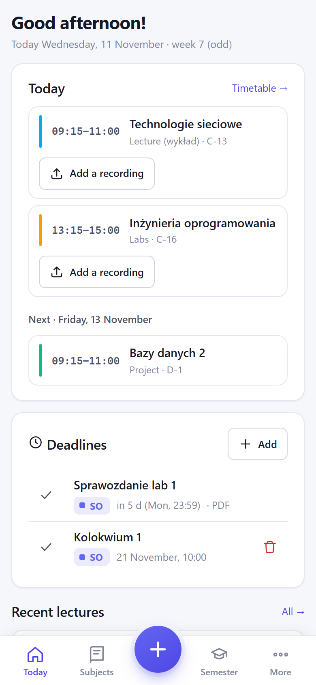

# How to use Konspekt

[Українська](GUIDE.md) · **English** · [Русский](GUIDE.ru.md)

This guide is for people who have already installed the app following the [README](../README.en.md) and opened it in the browser (`http://127.0.0.1:8765`).
The subjects and lectures in the screenshots are made up; you will see your own.

## 1. Language and first launch

Open **Settings** (left menu, at the bottom). In the top right corner is **Interface language**: Українська, English or Русский.
The choice is remembered and also applies on your phone.

In the same place, a bit lower:
- **USOS — timetable**. In USOSweb open "Mój plan" → "Udostępnij plan", copy the link, paste it here and press **Connect**.
  Subjects, rooms and class dates appear by themselves.
- **Local transcription (Whisper)** → **Install**. Free audio transcription on your PC. Without it, Claude transcribes the audio.
- **ePortal** (optional) → **Connect ePortal**. Materials and deadlines will be pulled in automatically.

## 2. Connect Claude (once)

The notes are written by your own Claude: it reads the app's data folder and puts the finished PDFs there.

1. In Settings, find the **Connect Claude** block and press **Folder path**: the path is copied.
2. Open Claude Desktop → **Cowork** → create a project "Konspekt" and choose that path as its folder.
3. Press **Project instructions** and paste the copied text into the project instructions in Cowork.

From now on, whenever you need notes, write in a new chat of this project: **"Process new lectures"**.

## 3. Home — "Today"

- **Today**: today's classes. Next to each is **Add a recording**, and during class **Record**.
- **Deadlines**: what to submit and by when, from ePortal and the ones you added yourself (**Add**).
- **Recent lectures**: a click opens the lecture. "Done" and PDF mean the notes are already there.
- Left menu: **Today**, **Subjects**, **Semester**, **Add / record**. The rest (timetable, planner, search, settings) is under "More".

## 4. Add a lecture

Press **Add / record** (or **Add files** on the home page).

1. Drag files into the big box or click it: audio, Teams video, a presentation, board photos.
2. The app fills in subject, date and time from the timetable. Check them in **About the lecture**.
3. On the right, tick **Transcribe on this PC** and **Send to Claude for notes**.
4. Press **Save lecture**.

To record a lecture straight from the phone: the **Record a lecture** button on the home page.

## 5. Get the notes

When lectures are waiting for Claude, a hint appears on the home page. Write **"Process new lectures"** in the Cowork project chat.
A few seconds after Claude finishes, the notes appear in the app by themselves.

- **Open PDF**: 3–4 pages of notes.
- **Redo notes**: if you want them different, for example more detailed. You can add your wishes.
- **Add files**: send slides or the second part of the recording later.
- Below are collapsed sections: notes, files, transcript, personal notes. A click opens each one.

## 6. A lab: working in a chat with Claude

A lab, exercises or a seminar are best done in a separate chat with Claude rather than through the queue.

1. Open the lab and add the task description in the **Task** section (PDF, screenshot, photo).
2. In the **Working in a chat with Claude** block, briefly write what you need, e.g. "make the instruction" or "step 3 fails with an error".
3. Press **Copy request** and paste it into a **new** chat of the "Konspekt" project in Cowork.
4. Claude reads the task, your code and the log of previous chats. At the end it adds to the **Chat log**: what's done and what's next.
   The next chat continues from the same place.
5. In **To submit**, tick the finished items, and once you've handed it in, press **Submitted**.

The **.zip pack** is for a chat without folder access, for example on the phone.

## 7. Subject and project

Open **Subjects** → the subject you need. There are three tabs:
- **Classes**: all lectures, labs and meetings by date; a type filter on top.
- **Project**: appears if the subject has a project.
- **Materials**: subject files and links, topic plan, course map.

In **Project**, the stages with dates are at the top. When you hand in a stage, press **"…" submitted → next stage**.
Below is the same **Working in a chat with Claude** block as in a lab.

Two more buttons at the top of the subject page. **Script PDF** merges all notes of the subject into one file.
**Preparing for a test**: Claude makes a cheat sheet before a colloquium.

## 8. Share notes with a classmate

In Settings, the **Sharing notes** block (in the screenshot in section 2).

**To give:**
1. Tick the subjects (each shows how many notes it has).
2. If you like, expand **What else to add**: transcripts, slides, projects.
3. Type your name and press **Download pack**. Send the `.zip` any way you like.

Audio, your personal notes, grades and access keys never go into the pack.

**To receive:** drag the `.zip` into **Choose or drop a .zip** and look at what the app is going to add.
Then press **Import**. Your own notes are never overwritten.

## 9. Phone

On the phone there are five buttons at the bottom: **Today**, **Subjects**, a big **+** (add or record a lecture), **Semester**, **More**.
How to open the app on the phone outside home (Tailscale) is described in the [README](../README.en.md#phone).

## If something is wrong

- **The notes don't appear.** Check that the app's `data` folder is selected in the Cowork chat. Then write "Process new lectures" again.
- **Wrong subject or date.** On the lecture page press **Edit**.
- **The USOS timetable doesn't update.** The "Udostępnij plan" link may be outdated: copy a new one into Settings.
