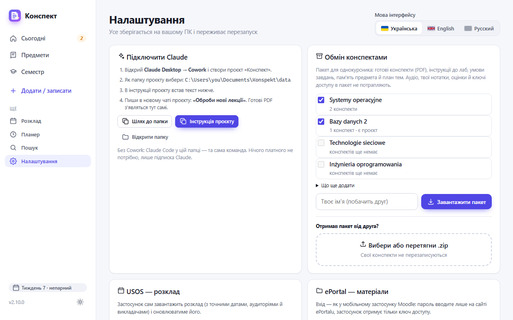
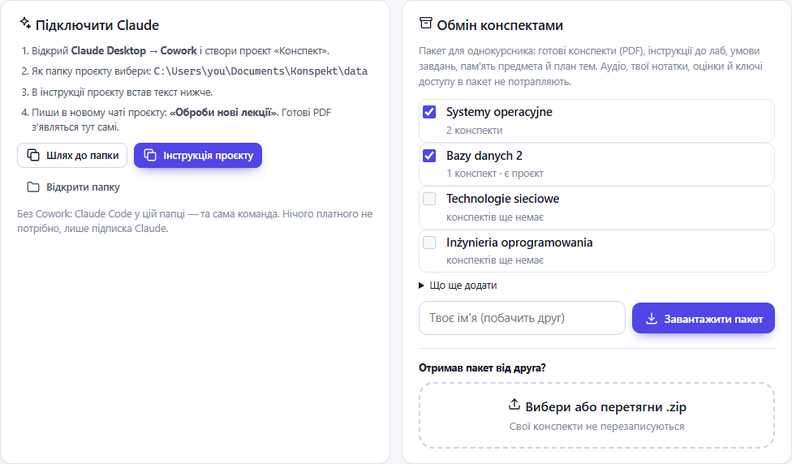
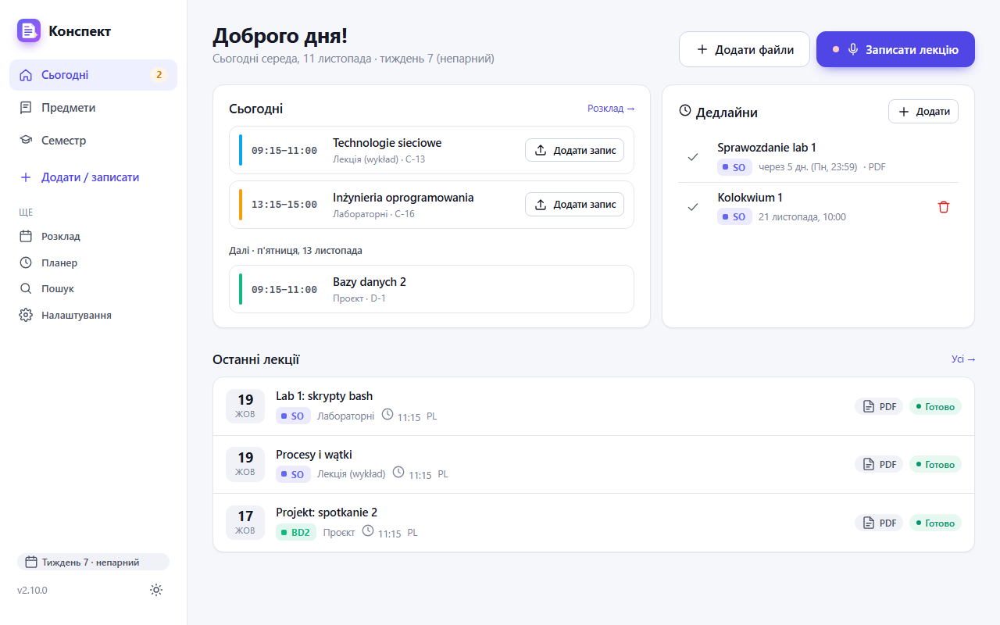
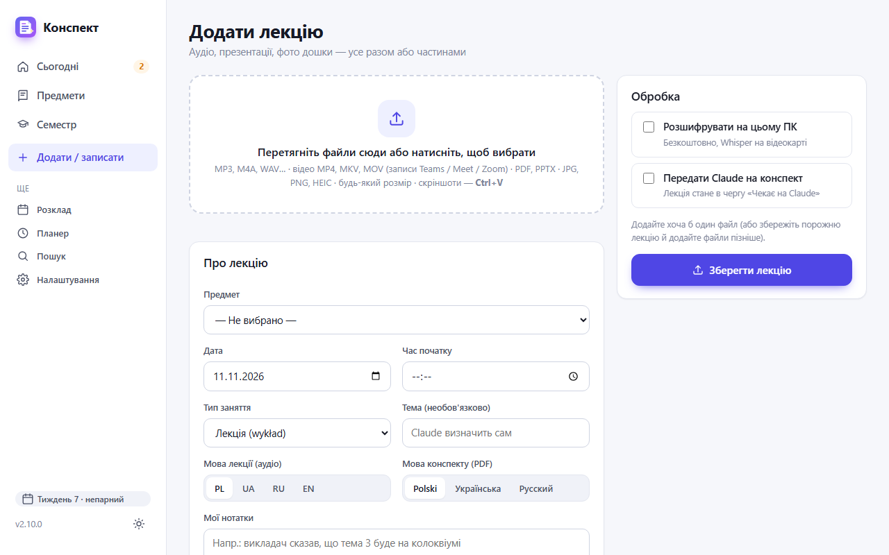
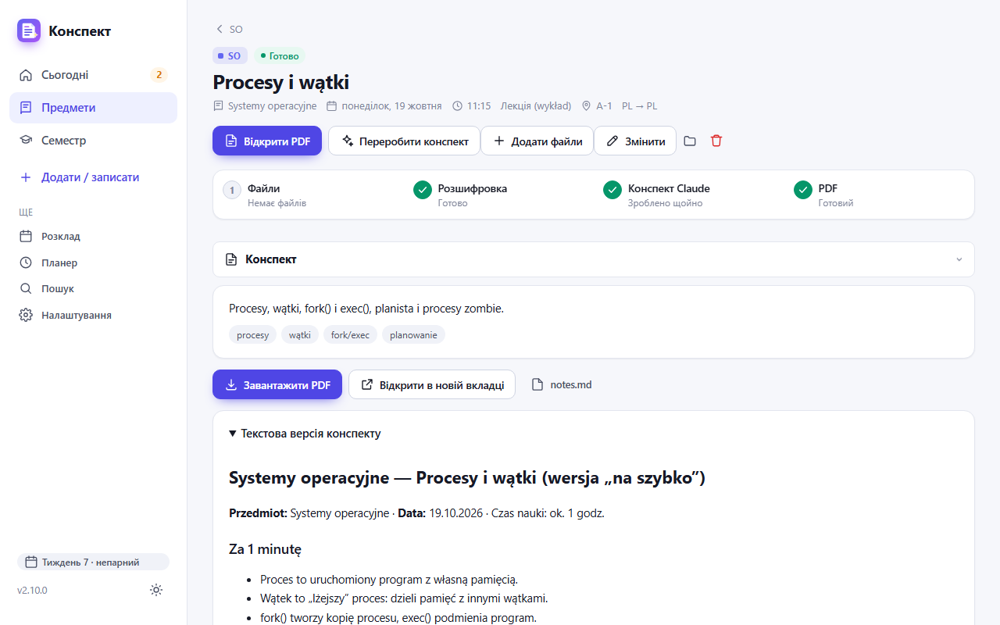
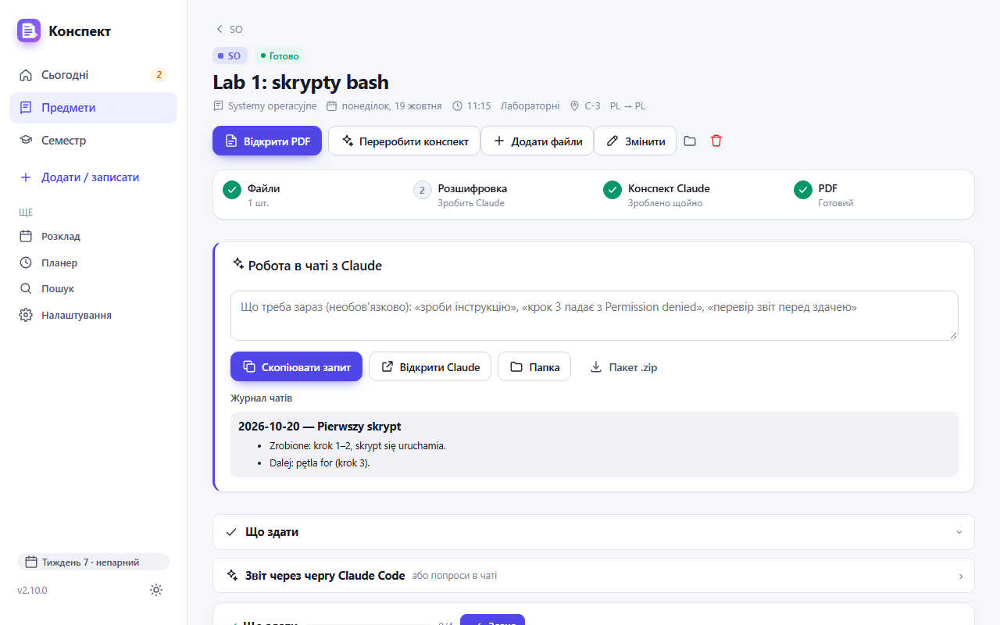
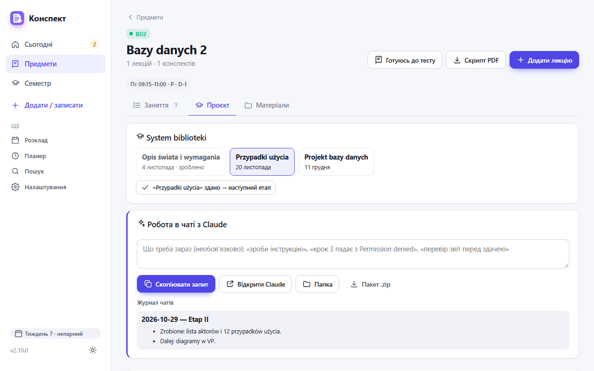
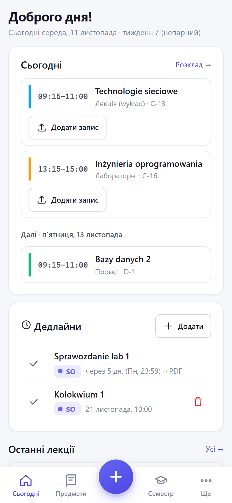

# Як користуватися «Конспектом»

**Українська** · [English](GUIDE.en.md) · [Русский](GUIDE.ru.md)

Інструкція для тих, хто вже встановив застосунок за [README](../README.md) і відкрив його в браузері (`http://127.0.0.1:8765`).
На знімках вигадані предмети й лекції; у тебе там будуть твої.

## 1. Мова і перший запуск

Відкрий **Налаштування** (ліве меню, внизу). Угорі праворуч — **Мова інтерфейсу**: Українська, English або Русский.
Вибір запам'ятовується і діє також на телефоні.

Там само, трохи нижче:
- **USOS — розклад**. У USOSweb відкрий «Mój plan» → «Udostępnij plan», скопіюй посилання, встав його сюди й натисни **Підключити**.
  Предмети, аудиторії та дати занять з'являться самі.
- **Локальна розшифровка (Whisper)** → **Встановити**. Це безкоштовна розшифровка аудіо на твоєму ПК. Без неї аудіо розшифрує Claude.
- **ePortal** (необов'язково) → **Підключити ePortal**. Матеріали й дедлайни підтягуватимуться самі.

## 2. Підключити Claude (один раз)

Конспекти пише твій Claude: він читає папку з даними застосунку і кладе туди готові PDF.

1. У Налаштуваннях знайди блок **Підключити Claude** і натисни **Шлях до папки**: шлях скопіюється.
2. Відкрий Claude Desktop → **Cowork** → створи проєкт «Конспект» і як його папку вибери цей шлях.
3. Натисни **Інструкція проєкту** і встав скопійований текст в інструкцію проєкту в Cowork.

Тепер щоразу, коли треба конспект, пишеш у новому чаті цього проєкту: **«Оброби нові лекції»**.

## 3. Головна — «Сьогодні»

- **Сьогодні**: пари на сьогодні. Біля кожної кнопка **Додати запис**, а під час пари **Записати**.
- **Дедлайни**: що здати й до коли, з ePortalu й ті, що ти додав сам (**Додати**).
- **Останні лекції**: клік відкриває лекцію. «Готово» і PDF означають, що конспект уже є.
- Ліве меню: **Сьогодні**, **Предмети**, **Семестр**, **Додати / записати**. Решта (розклад, планер, пошук, налаштування) — у розділі «Ще».

## 4. Додати лекцію

Натисни **Додати / записати** (або **Додати файли** на головній).

1. Перетягни файли у велике поле або натисни на нього: аудіо, відео з Teams, презентацію, фото дошки.
2. Предмет, дату й час застосунок підставить за розкладом. Перевір їх у блоці **Про лекцію**.
3. Праворуч познач **Розшифрувати на цьому ПК** і **Передати Claude на конспект**.
4. Натисни **Зберегти лекцію**.

Записати лекцію прямо з телефона: кнопка **Записати лекцію** на головній.

## 5. Отримати конспект

Коли лекції чекають на Claude, на головній з'явиться підказка. Напиши в чаті проєкту Cowork **«Оброби нові лекції»**.
За кілька секунд після того, як Claude закінчить, конспект з'явиться в застосунку сам.

- **Відкрити PDF**: конспект на 3–4 сторінки.
- **Переробити конспект**: якщо хочеш інакше, наприклад детальніше. Можна дописати побажання.
- **Додати файли**: дослати слайди чи другу частину запису.
- Нижче згорнуті розділи: конспект, файли, розшифровка, нотатки. Клік відкриває кожен.

## 6. Лаба: робота в чаті з Claude

Лабу, вправи чи семінар краще робити в окремому чаті з Claude, а не через чергу.

1. Відкрий лабу й додай умову в розділ **Завдання** (PDF, скріншот, фото).
2. У блоці **Робота в чаті з Claude** коротко напиши, що треба, наприклад «зроби інструкцію» або «крок 3 падає з помилкою».
3. Натисни **Скопіювати запит** і встав його в **новий** чат проєкту «Конспект» у Cowork.
4. Claude прочитає умову, твій код і журнал минулих чатів. Наприкінці він допише **Журнал чатів**: що зроблено й що далі.
   Наступний чат продовжить з того самого місця.
5. У розділі **Що здати** відмічай зроблені пункти, а коли здав, натисни **Здано**.

**Пакет .zip** знадобиться, якщо чат без доступу до папки, наприклад на телефоні.

## 7. Предмет і проєкт

Відкрий **Предмети** → потрібний предмет. Там три вкладки:
- **Заняття**: усі лекції, лаби й зустрічі за датою; угорі фільтр за типом.
- **Проєкт**: з'являється, якщо в предметі є проєкт.
- **Матеріали**: файли й посилання предмета, план тем, карта курсу.

У **Проєкті** вгорі етапи з датами. Коли здаєш етап, натисни кнопку **«…» здано → наступний етап**.
Нижче той самий блок **Робота в чаті з Claude**, що й у лабі.

Угорі сторінки предмета ще дві кнопки. **Скрипт PDF** збирає всі конспекти предмета в один файл.
**Готуюсь до тесту**: Claude складе шпаргалку перед колоквіумом.

## 8. Поділитися конспектами з однокурсником

У Налаштуваннях блок **Обмін конспектами** (на знімку в розділі 2).

**Віддати:**
1. Познач предмети (біля кожного видно, скільки конспектів).
2. За бажанням розгорни **Що ще додати**: розшифровки, слайди, проєкти.
3. Впиши своє ім'я і натисни **Завантажити пакет**. Надішли `.zip` будь-яким способом.

Аудіо, твої нотатки, оцінки й ключі доступу в пакет не потрапляють.

**Отримати:** перетягни `.zip` у поле **Вибери або перетягни .zip** і подивись, що застосунок додасть.
Потім натисни **Імпортувати**. Твої власні конспекти не перезаписуються.

## 9. Телефон

На телефоні внизу п'ять кнопок: **Сьогодні**, **Предмети**, велика **+** (додати чи записати лекцію), **Семестр**, **Ще**.
Як відкрити застосунок на телефоні поза домом (Tailscale), описано в [README](../README.md#телефон).

## Якщо щось не так

- **Конспект не з'являється.** Перевір, що в чаті Cowork вибрано папку `data` застосунку. Потім ще раз напиши «Оброби нові лекції».
- **Неправильний предмет чи дата.** На сторінці лекції натисни **Змінити**.
- **Розклад з USOS не оновлюється.** Посилання «Udostępnij plan» могло застаріти: скопіюй нове в Налаштуваннях.
