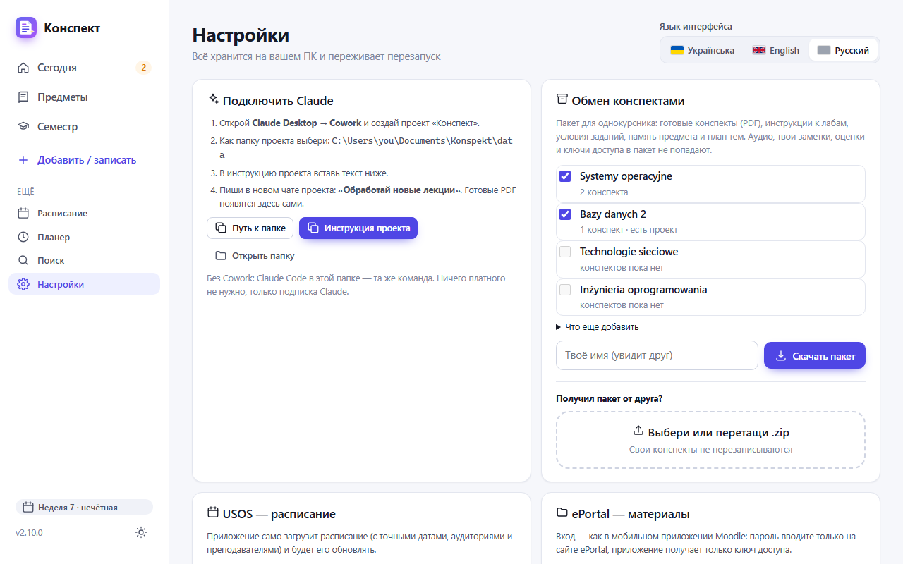
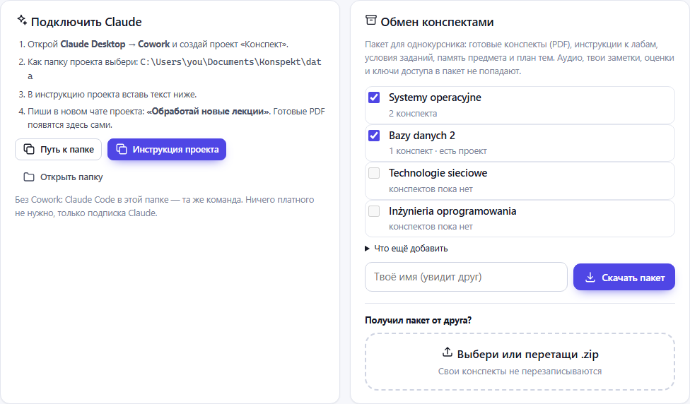
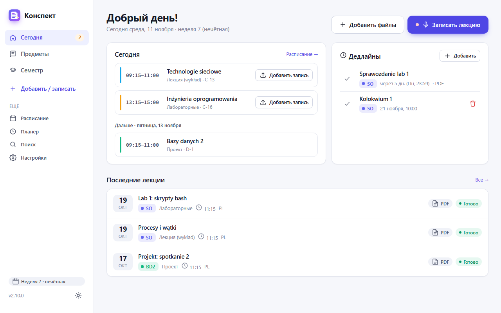
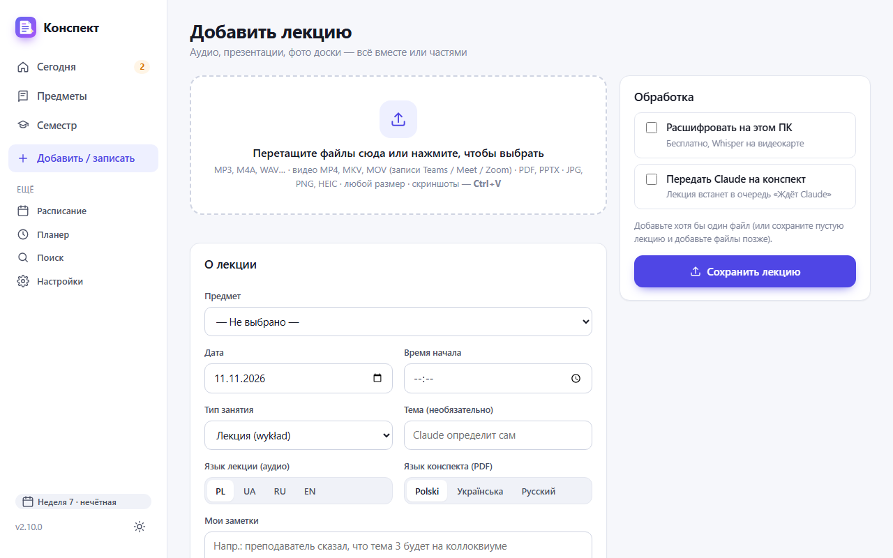
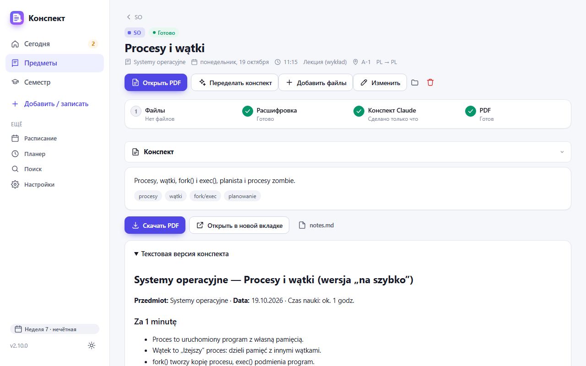
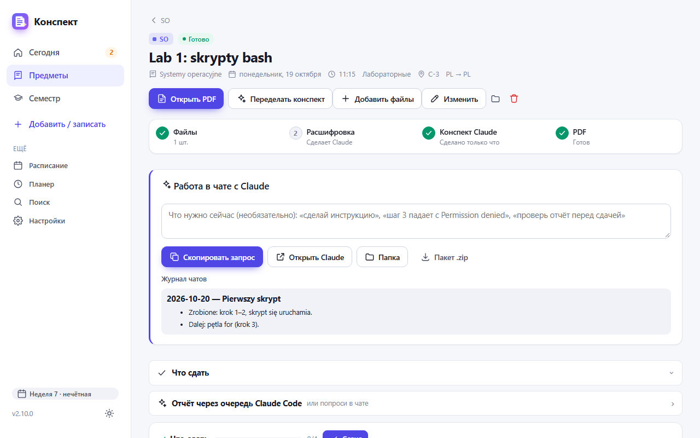
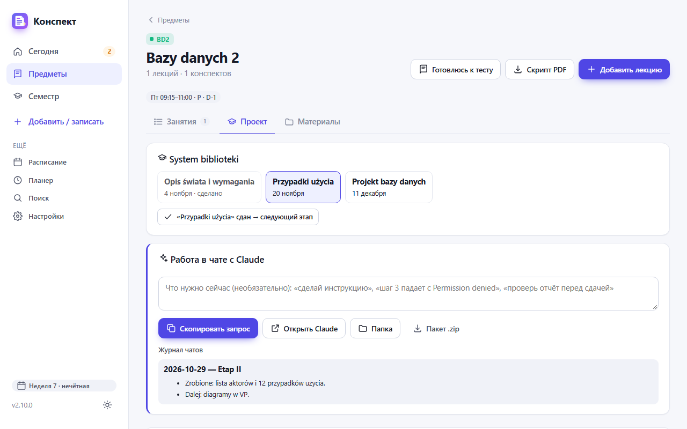
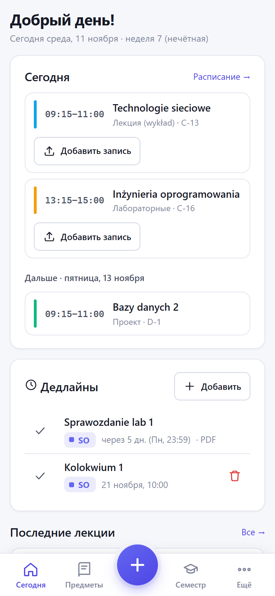

# Как пользоваться «Конспектом»

[Українська](GUIDE.md) · [English](GUIDE.en.md) · **Русский**

Инструкция для тех, кто уже установил приложение по [README](../README.ru.md) и открыл его в браузере (`http://127.0.0.1:8765`).
На снимках выдуманные предметы и лекции; у тебя там будут твои.

## 1. Язык и первый запуск

Открой **Настройки** (левое меню, внизу). Вверху справа — **Язык интерфейса**: Українська, English или Русский.
Выбор запоминается и действует также на телефоне.

Там же, чуть ниже:
- **USOS — расписание**. В USOSweb открой «Mój plan» → «Udostępnij plan», скопируй ссылку, вставь её сюда и нажми **Подключить**.
  Предметы, аудитории и даты занятий появятся сами.
- **Локальная расшифровка (Whisper)** → **Установить**. Это бесплатная расшифровка аудио на твоём ПК. Без неё аудио расшифрует Claude.
- **ePortal** (необязательно) → **Подключить ePortal**. Материалы и дедлайны будут подтягиваться сами.

## 2. Подключить Claude (один раз)

Конспекты пишет твой Claude: он читает папку с данными приложения и кладёт туда готовые PDF.

1. В Настройках найди блок **Подключить Claude** и нажми **Путь к папке**: путь скопируется.
2. Открой Claude Desktop → **Cowork** → создай проект «Конспект» и выбери этот путь как его папку.
3. Нажми **Инструкция проекта** и вставь скопированный текст в инструкцию проекта в Cowork.

Теперь каждый раз, когда нужен конспект, пишешь в новом чате этого проекта: **«Обработай новые лекции»**.

## 3. Главная — «Сегодня»

- **Сегодня**: пары на сегодня. Рядом с каждой кнопка **Добавить запись**, а во время пары **Записать**.
- **Дедлайны**: что сдать и к какому сроку, из ePortal и те, что ты добавил сам (**Добавить**).
- **Последние лекции**: клик открывает лекцию. «Готово» и PDF значат, что конспект уже есть.
- Левое меню: **Сегодня**, **Предметы**, **Семестр**, **Добавить / записать**. Остальное (расписание, планер, поиск, настройки) — в разделе «Ещё».

## 4. Добавить лекцию

Нажми **Добавить / записать** (или **Добавить файлы** на главной).

1. Перетащи файлы в большое поле или нажми на него: аудио, видео из Teams, презентацию, фото доски.
2. Предмет, дату и время приложение подставит по расписанию. Проверь их в блоке **О лекции**.
3. Справа отметь **Расшифровать на этом ПК** и **Передать Claude на конспект**.
4. Нажми **Сохранить лекцию**.

Записать лекцию прямо с телефона: кнопка **Записать лекцию** на главной.

## 5. Получить конспект

Когда лекции ждут Claude, на главной появится подсказка. Напиши в чате проекта Cowork **«Обработай новые лекции»**.
Через несколько секунд после того, как Claude закончит, конспект появится в приложении сам.

- **Открыть PDF**: конспект на 3–4 страницы.
- **Переделать конспект**: если хочешь иначе, например подробнее. Можно дописать пожелания.
- **Добавить файлы**: дослать слайды или вторую часть записи.
- Ниже свёрнутые разделы: конспект, файлы, расшифровка, заметки. Клик открывает каждый.

## 6. Лаба: работа в чате с Claude

Лабу, упражнения или семинар лучше делать в отдельном чате с Claude, а не через очередь.

1. Открой лабу и добавь условие в раздел **Задание** (PDF, скриншот, фото).
2. В блоке **Работа в чате с Claude** коротко напиши, что нужно, например «сделай инструкцию» или «шаг 3 падает с ошибкой».
3. Нажми **Скопировать запрос** и вставь его в **новый** чат проекта «Конспект» в Cowork.
4. Claude прочитает условие, твой код и журнал прошлых чатов. В конце он допишет **Журнал чатов**: что сделано и что дальше.
   Следующий чат продолжит с того же места.
5. В разделе **Что сдать** отмечай сделанные пункты, а когда сдал, нажми **Сдано**.

**Пакет .zip** пригодится, если чат без доступа к папке, например на телефоне.

## 7. Предмет и проект

Открой **Предметы** → нужный предмет. Там три вкладки:
- **Занятия**: все лекции, лабы и встречи по дате; вверху фильтр по типу.
- **Проект**: появляется, если в предмете есть проект.
- **Материалы**: файлы и ссылки предмета, план тем, карта курса.

В **Проекте** вверху этапы с датами. Когда сдаёшь этап, нажми кнопку **«…» сдан → следующий этап**.
Ниже тот же блок **Работа в чате с Claude**, что и в лабе.

Вверху страницы предмета ещё две кнопки. **Скрипт PDF** собирает все конспекты предмета в один файл.
**Готовлюсь к тесту**: Claude составит шпаргалку перед коллоквиумом.

## 8. Поделиться конспектами с однокурсником

В Настройках блок **Обмен конспектами** (на снимке в разделе 2).

**Отдать:**
1. Отметь предметы (рядом с каждым видно, сколько конспектов).
2. По желанию раскрой **Что ещё добавить**: расшифровки, слайды, проекты.
3. Впиши своё имя и нажми **Скачать пакет**. Отправь `.zip` любым способом.

Аудио, твои заметки, оценки и ключи доступа в пакет не попадают.

**Получить:** перетащи `.zip` в поле **Выбери или перетащи .zip** и посмотри, что приложение добавит.
Потом нажми **Импортировать**. Твои собственные конспекты не перезаписываются.

## 9. Телефон

На телефоне внизу пять кнопок: **Сегодня**, **Предметы**, большая **+** (добавить или записать лекцию), **Семестр**, **Ещё**.
Как открыть приложение на телефоне вне дома (Tailscale), описано в [README](../README.ru.md#телефон).

## Если что-то не так

- **Конспект не появляется.** Проверь, что в чате Cowork выбрана папка `data` приложения. Потом ещё раз напиши «Обработай новые лекции».
- **Неправильный предмет или дата.** На странице лекции нажми **Изменить**.
- **Расписание из USOS не обновляется.** Ссылка «Udostępnij plan» могла устареть: скопируй новую в Настройках.
